# 👋 Hey, I'm Rohan Phulkar

### Full Stack Engineer · Backend Systems · DevOps & Cloud

<p align="center">
  
</p>

<p align="center">
  <a href="https://github.com/rohanphulkar?tab=repositories">
    
  </a>
  <a href="https://github.com/rohanphulkar?tab=followers">
    
  </a>
</p>

---

## `$ whoami`

I'm a software engineer who enjoys building **scalable applications, reliable backend systems, and cloud infrastructure**.

I go beyond making software work. I'm interested in understanding how systems behave under load, how distributed components communicate, how failures happen, and how to build software that remains reliable as it grows.

- 🔭 Building full-stack products and backend-heavy applications.
- ⚙️ Exploring system design, distributed systems, and event-driven architecture.
- ☁️ Working with cloud infrastructure, Docker, and CI/CD.
- 🤖 Exploring AI engineering, LLM integrations, and RAG applications.
- 🧩 Strengthening problem-solving skills through DSA and system design.
- 🎯 Focused on maintainable, observable, production-ready software.

> **Knowledge is my curse. Growth is my purpose. Engineering is my craft.**

---

## 🛠️ Tech Stack

<p align="center">
  <strong>Languages & Frameworks</strong>
  <br/><br/>
  
</p>

<p align="center">
  <strong>Databases & Messaging</strong>
  <br/><br/>
  
</p>

<p align="center">
  <strong>Cloud, DevOps & Infrastructure</strong>
  <br/><br/>
  
</p>

<p align="center">
  <strong>Developer Tools & Frontend</strong>
  <br/><br/>
  
</p>

<details>
  <summary><strong>🔍 More about my technical interests</strong></summary>

  <br/>

  - **Backend:** FastAPI, Django, Flask, Node.js, Express, REST APIs
  - **Frontend:** React, Next.js, TypeScript, Tailwind CSS
  - **Databases:** PostgreSQL, MySQL, MongoDB, Redis
  - **Messaging:** Apache Kafka, RabbitMQ, asynchronous processing
  - **Distributed systems:** Saga pattern, transactional outbox, service communication, caching, rate limiting
  - **Cloud & DevOps:** AWS, GCP, Docker, Linux, CI/CD, Nginx
  - **Observability:** Prometheus, Grafana, application logging
  - **AI engineering:** LLM APIs, RAG, Qdrant, vector search

</details>

---

## 📊 GitHub Statistics

<p align="center">
  
</p>

<p align="center">
  
</p>

<p align="center">
  
</p>

---

## 📈 Contribution Graph

<p align="center">
  
</p>

<!-- BEGIN ACTIVITY-GRAPH -->
<picture>
  <source media="(max-width: 767px)" srcset="activity-graph-mobile.svg">
  
</picture>
<!-- END ACTIVITY-GRAPH -->

---

## 🧠 Currently Exploring

```python
class Engineer:
    def __init__(self):
        self.focus = [
            "System Design",
            "Distributed Systems",
            "DevOps & Cloud",
            "Agentic AI Engineering",
        ]
        self.mindset = "Build. Break. Learn. Improve."

    def next_step(self):
        return "Turn knowledge into production-ready projects"


me = Engineer()
print(me.next_step())
```

---

## 🤝 Let's Connect

I'm always interested in discussing backend engineering, system design, distributed systems, cloud infrastructure, and interesting software projects.

<p align="center">
  <a href="https://github.com/rohanphulkar">
    
  </a>
  <a href="https://linkedin.com/in/rohanphulkar">
    
  </a>
  <a href="mailto:hello@rohanphulkar.com">
    
  </a>
</p>

<p align="center">
  <i>"Great software is built through curiosity, thoughtful design, and continuous improvement."</i>
</p>

<p align="center">
  
</p>
